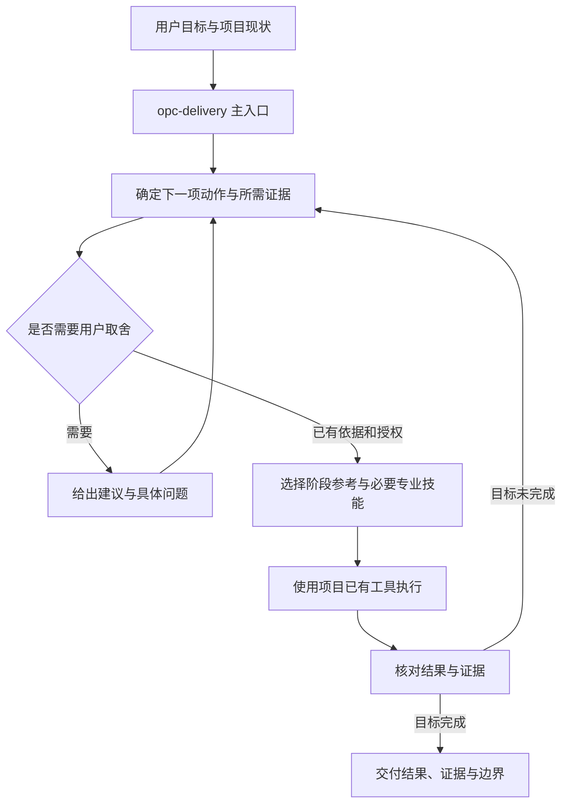

# OPC Delivery：整体技能设计

日期：2026-10-24。设计基线：0.3.0，提交 `65971e8`。状态：2026-10-26 用户确认整体设计并授权开工；本文件描述目标设计，实际完成情况见验证记录。

## 1. 产品定位与成功标准

**已确定的核心用途：把一个产品推进到可验证的上线。**

默认服务有开发基础的独立开发者，既支持新产品，也支持已有项目从开发、修复或发布阶段进入。用户明确要求单项工作时，以该项结果为终点；“交付上线”的定位不自动扩大每次任务范围。

主入口的承诺是：从当前事实出发，找到阻碍目标完成的关键问题，取得必要证据，持续完成已授权工作，直到目标满足或遇到确切的外部依赖。

评判价值看：是否完成约定的用户结果、是否遗漏关键条件、是否造成返工、是否提出无效问题、结论是否有证据。技能数量、文档长度和测试条数只说明覆盖或工程状态。

## 2. 设计基线盘点（0.3.0）

| 领域 | 当时配套 | 当时边界 |
| --- | --- | --- |
| 产品与用户 | user-research、market-research、prd | 已有研究、市场与规格方法；上线后的采用/留存/价值实验尚未形成完整衔接 |
| UI/UX | frontend-design、web-design-guidelines、prototype-validation | 覆盖设计、规范与可用性；真实用户测试仍需实际参与者和执行条件 |
| 前端 | vercel-react-best-practices、vercel-composition-patterns | 重点是 React/Next.js；不代表通用前端全部覆盖 |
| 后端 | python-fastapi、java-springboot、architecture-patterns、python-sqlalchemy、python-testing | 主要覆盖 Python/Java；数据迁移与系统安全按项目补专题 |
| Agent | ecosystem-primer 及 LangChain/LangGraph/Deep Agents 共 11 项 | 框架材料充分；跨框架的任务质量评测、成本与失败集方法较弱 |
| 调试与验证 | systematic-debugging、test-driven-development | 根因与回归方法已有；跨层业务验收由主流程协调 |
| 工程与运维 | using-git-worktrees、verification-before-completion、requesting-code-review、deployment-operations | 有隔离、评审、发布恢复方法；具体云平台命令依项目实际入口 |

设计基线合计 30 项：27 项导入快照，3 项本项目编写。35 项自动测试主要证明工具、安装及文件完整性；三项新专业技能有合成材料的独立任务验证。尚无足够的真实交付对照证明整体效率或质量提升。

优先缺口在组合规则：怎样选择当前问题、专业技能如何接收上下文和交回结果、证据何时足以进入下一步、指令冲突怎样处理。现有主入口已有这些原则，下一步要把关键判断写得更具体。

### 当前落地状态（0.5.0）

- P0 的推进循环与专业接入约定已在 0.4.0 完成，8 例前后对照均通过；未测出效率或质量提升，见 [核心验证](validation-core-loop.md)。
- 用户于 2026-10-26 授权继续第二阶段，优先补产品价值和通用 Agent 评测。两项具有独立触发、方法和复用材料，已分别建立 `product-value-validation` 与 `agent-evaluation`；案例及发布验证见 [第二阶段记录](validation-value-agent-0.5.0.md)。
- 当前 32 项配套：27 项导入快照、5 项本项目专业能力。产品价值覆盖事件、成熟窗口、留存/付款及实验决定；通用 Agent 评测覆盖任务/评分/实际状态、副作用、保留集和质量/成本/延迟比较。真实用户研究、真实模型运行与业务收益仍需各项目执行取证。
- 尚待实际项目驱动的缺口：安全、数据迁移与跨层业务验收专题，以及更多框架/平台支持。本轮不扩展这些方向。

## 3. 整体结构

采用一个主入口与按需调用的专业技能。交付阶段属于主流程的视角，不为每个阶段再创建一个重复的顶层 Skill。

| 层 | 职责 | 文件落点 |
| --- | --- | --- |
| 主入口 | 识别目标、选择进入点、协调工作、控制完成声明 | 根 SKILL.md、agents/openai.yaml |
| 交付方法 | 选择下一动作、推进/退回/等待判断、阶段证据要求 | references/delivery-loop.md；复用现有 discovery/development/verification/release 等参考 |
| 专业技能 | 在给定范围内研究、设计、实现或验证，返回专业证据 | skills/ 下的 32 项；references/skill-recommendations.md 负责选择 |
| 工具与材料 | 执行确定性操作、提供模板、安装分发与文件溯源 | scripts/、assets/、bin/、skills/manifest.json；实际业务工具来自目标项目或当前环境 |

主入口拥有当前任务的协调责任；各专业技能拥有各自方法；项目仓库继续拥有业务事实、架构与发布状态。跨会话沿用已有 Issue、任务记录或项目文档，避免复制出另一套状态系统。

主入口保留核心循环和结束条件的短版；复杂排序、冲突与恢复细节再按需读取 delivery-loop。必要行为不能全部藏在可选链接后。小任务无需先读完整方法库。

## 4. 核心推进机制

### 4.1 每次选择一个值得推进的动作

按以下顺序判断，不使用缺乏依据的数值评分：

1. 如果正在发生用户影响或数据损害，先评估并实施已授权的控制影响动作，同时保留证据。
2. 找到当前目标必须满足的条件，区分已满足、未验证、已失败。已有足够依据的工作直接执行。
3. 若多个未知阻碍推进，先处理其他动作依赖的上游问题，再比较答案改变范围/方案/发布决定的可能性及取证成本。
4. 选择能够区分候选解释或满足缺失条件的最小动作。成功和失败各会怎样改变下一步，执行前应能说明。
5. 新结果改变了前提时，退回最近受影响的决定；有效的既有工作继续复用。

独立且已明确的工作可以并行；单个阻塞点不应暂停其他可完成内容。并行方式依当前环境和授权，技能包本身不保证子 Agent 能力。

### 4.2 按未知的性质选择手段

| 当前缺什么 | 下一步 |
| --- | --- |
| 环境事实、代码行为、版本或工具状态 | 自己读取、查询、复现；能查到的信息不让用户重复提供 |
| 会改变范围、成本、体验或责任边界的偏好 | 向用户提出具体选择、依据和推荐；已有决定与授权直接复用 |
| 真实用户行为、技术可行性或恢复能力 | 设计并执行权限范围内的验证；讨论和模拟不能代替实际证据 |
| 已明确的实现或发布工作 | 直接执行，按风险验证结果 |
| 只能由外部人员、账号或现场提供的条件 | 说明确切依赖、已完成内容和恢复工作的触发条件；继续独立工作 |

类似 grilling 的方法可以用于需要深入取舍的局部问题。它不成为所有任务的强制前置，也不以穷尽问题树作为已明确任务的开工条件。

### 4.3 推进、退回和结束

| 观测结果 | 动作 |
| --- | --- |
| 当前完成条件满足，但用户目标尚未达到 | 带着该证据进入下一项必要工作 |
| 验证失败，原因还不明确 | 做最小的区分性调查，不能靠增加报告数量推进 |
| 新证据推翻了已接受前提 | 指明受影响决定；涉及用户已定范围/验收时让用户决定变更，其余工作继续 |
| 操作结果未知，例如部署请求超时 | 先查真实状态，再决定重试；不把未知记为失败或成功 |
| 连续动作未增加证据或改变可执行状态 | 改变调查手段或明确依赖，避免重复同一无效动作 |
| 约定目标及其必要验证已满足 | 用实际结果、证据和剩余边界结束；后续建议不自动扩展当前任务 |

## 5. 阶段之间交什么

阶段按问题进入，可跳过已经具备证据的部分。表中材料复用现有记录，不要求每次创建对应文档。

| 交付点 | 进入条件 | 交回内容 | 进入下一步的依据 / 需要返回的情况 |
| --- | --- | --- | --- |
| 需求判断 | 目标用户、问题或价值存在关键未知 | 问题证据、适用人群、假设与最小验证 | 足以界定获准的实验或实现范围；没有商业证据时保持实验身份 |
| 范围与方案 | 已明确要解决的问题或具体功能 | 最短用户路径、验收样例、重要失败路径、必要取舍 | 实现者能判断完成；重大取舍仍不明确则回到相应决定 |
| 原型/技术验证 | 流程理解或核心技术会影响方案 | 原型版本、模拟范围、任务结果或技术测量 | 证据支持选定方向；失败时调整具体假设，不直接扩大建设 |
| 实现 | 范围与验收足够明确 | 最小纵向改动、契约影响、相关测试 | 验收样例成立；发现需求冲突返回范围决定，代码故障进入调试 |
| 验收 | 有与目标对应的实现及可检查环境 | 当前版本的功能、集成和必要业务路径证据 | 满足目标与发布前提；缺失/跳过项目门禁不记为通过 |
| 发布 | 产物、环境、配置和数据变更条件已明确 | 实际发布版本、业务冒烟、恢复路径 | 目标环境业务正确；健康通过但业务失败仍需处置 |
| 运行与反馈 | 已运行或有线上问题 | 用户影响、监测、恢复和产品反馈 | 故障按恢复条件关闭；用户价值与留存需要真实行为证据另行判断 |

## 6. 专业技能怎样接入

采用一个简短的交接约定，写入已有上下文即可。

- **输入**：当前目标与已有验收；相关事实及来源；本次问题与操作范围；期望交回的证据。
- **输出**：完成的动作或判断；证据位置、版本和实际状态；未解问题及其对下一步的影响。
- **协调规则**：总控核对输出是否满足当前目标，决定继续、退回或等待；专业技能不另起一套任务计划、改变已定产品范围或宣称整个项目完成。

加载顺序：主入口 → 当前必要阶段参考 → 一个主要专业方向及其必要依赖。名称和描述足以排除的技能不加载全文。底层工具不足时优先使用现有可行手段，并准确说明未验证范围。

同名技能同时存在时，明确采用包内快照或本机另一份，单次任务保持来源可追踪。LangChain 专题只在相应框架或明确选型任务中采用；自研运行时先使用项目入口与现有可靠性参考。

上游快照中的强制提问、TDD、worktree 或子 Agent 规则须先检查适用条件，并服从当前会话的上级指令、用户目标和项目约束。能使用其有效方法时使用；出现不可兼容要求时选择其他适用能力。必要的实际授权缺口仍需处理。

来源正文保持可追溯，协调规则放在 references/specialist-integration.md。确需修改快照时记录 local_changes 并更新哈希；不静默改写上游。

## 7. 用户能感知的协作节奏

首次接入简短说明：现在离目标还缺什么、先做什么、什么结果会改变下一步。只在重要阶段转换、出现新证据、发生阻塞或需要用户取舍时更新。

示例：“当前构建已通过，发布还缺目标环境的任务去重验证。我先沿提交与 worker 路径检查；如果一次请求产生多个持久化任务，就先修复再放量。”

不把上述字段变成每条消息必须填写的表单。小改动可以在同一轮完成定位、修改和验证；长任务只维护一个可恢复的主记录。

用户说“继续”时，先读取现有完成项、证据、未解问题与下一动作；用户更改目标时显式更新受影响范围，保留仍然有效的事实。

## 8. 补缺顺序

| 优先级 | 要解决的缺口 | 实施方式与启动条件 |
| --- | --- | --- |
| P0 | 核心推进规则、阶段交接和专业技能冲突 | 先定义行为案例与旧版基线，再细化主入口和两份协调参考；首轮不增加专业 Skill 数量 |
| P0 | 组合效果缺少可比较证据 | 同输入、同工具与权限、同预算的旧版/候选版独立任务；记录结果和失败，不只查文件标题 |
| P1 | 上线后产品价值验证 | 用户已授权本轮补齐；独立专业入口衔接研究、实验与反馈，实际验证见第二阶段记录 |
| P1 | 跨框架 Agent 质量评测 | 用户已授权本轮补齐；提供任务集、评分及质量/成本/延迟方法，复用已有 eval 入口，实际验证见第二阶段记录 |
| P1 | 项目所需安全、数据库迁移与业务验收 | 按实际数据、权限和迁移风险，优先接入已存在且适用的专业能力；经过实际任务再决定是否内置 |
| P2 | 更多框架、云平台与分发选项 | 由实际需求和维护能力驱动；引入前核对来源、依赖、许可、兼容性及更新成本 |

每个候选新增 Skill 必须回答：现有能力在哪个具体任务上不足；为什么独立技能比补参考更合适；输入、结果、证据和依赖是什么；如何验证并维护。材料覆盖缺口与运行环境缺口分别处理，不能用增加 Markdown 文件替代工具权限或实际执行。

## 9. 验证与维护

首轮以 0.3.0 为基线，在隔离环境比较候选设计，覆盖：模糊目标、明确小改动、跨层错误线索、旧版本证据、已有授权、前提被推翻、外部等待、专业技能不适用。

执行者只收到任务和必要原始材料；评分规则由评估者持有。记录验收结果、关键遗漏、错误声明、无效询问、返工与调用成本。相同条件下的单次案例只能说明该案例表现；需要重复观察才能推断稳定改进。

需要用户回答的案例，提前固定可提供的信息与答复规则，由评估者统一响应；避免对某一版本额外解释目标。若只能评估首轮响应，就明确限制，不能据此声称整条交付链更有效。

对已有公开项目问题，可以冻结原始提交做可复现任务；私有项目材料先匿名化并确认可用范围。真人访谈、生产发布和恢复演练另按真实授权执行，离线案例不替代这些证据。

保留三类独立记录：文件与安装完整性、专业技能案例、组合交付表现。没有测到收益时记录没有证据，不用测试数量填补结论。

首轮落地计划见 [核心推进机制实施计划](superpowers/plans/2026-10-24-skills-core.md)。后续专业能力补齐应在核心方法验证后按实际任务逐项立项。
